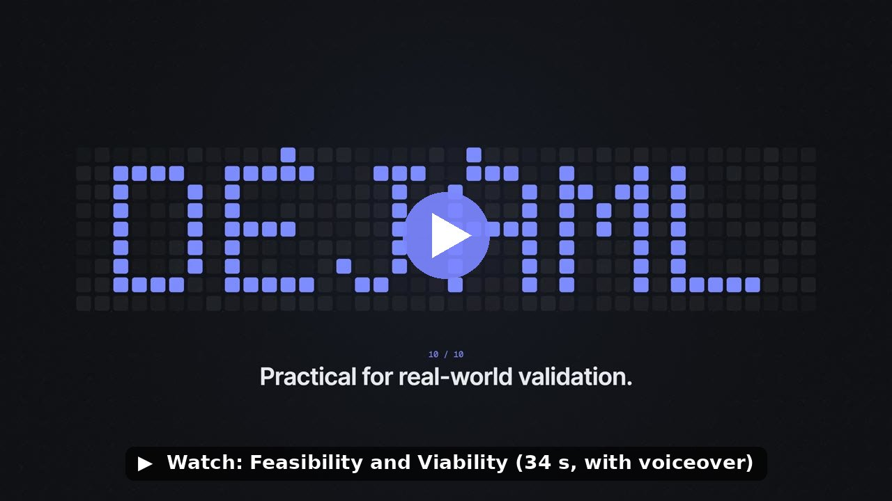
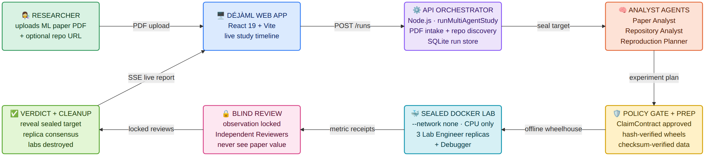
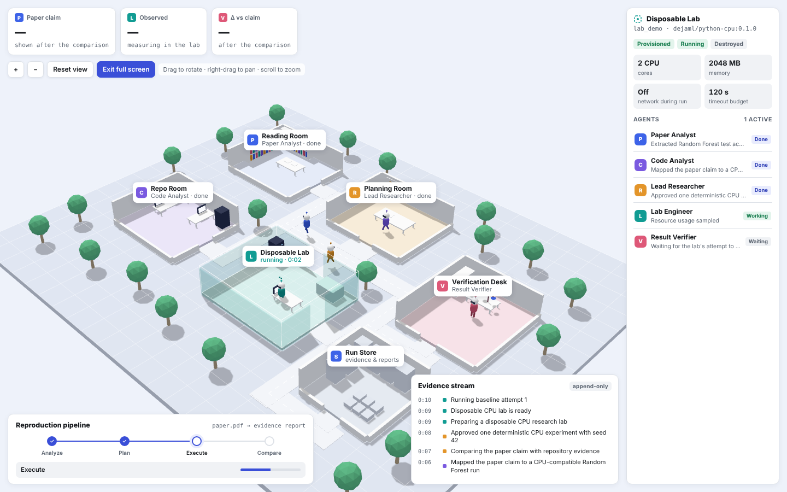

<div align="center">

# DéjàML (DejaML): AI agents that reproduce machine-learning papers

**Same claim. One more run.**

_Reproduce. Verify. Know._

DéjàML (also written DejaML or Deja ML) is an open-source tool for **ML paper
reproducibility**. It takes a machine-learning research paper, finds its GitHub
code, re-runs the experiment behind one of its published numbers in a sealed,
offline Docker lab with blinded AI agents, and tells you honestly whether the
result came back.

[GitHub](https://github.com/AayushBhat07/dejaml) ·
[YouTube](https://www.youtube.com/@ParthNaukudkar-q5g) ·
[Instagram](https://www.instagram.com/de_ja_ml/?hl=en) ·
[Working Report](https://drive.google.com/file/d/1UcDQmQssNe_REx6-ZFwt4cVscvJiiDXD/view?usp=sharing)

</div>

---

## Watch: Feasibility and Viability

[](docs/media/dejaml-feasibility-and-viability.mp4)

A 34-second narrated walkthrough of how DéjàML is deployed and scaled: one
continuous camera move from a cloud grid into a Linux node, its job queue, a
single Docker lab and its resource limits, and back out. Click the image to open
the video ([direct link](docs/media/dejaml-feasibility-and-viability.mp4)); the
full report is linked under [Reports and links](#reports-and-links).

## What is DéjàML?

Machine-learning papers report precise numbers, but checking one is slow and
error-prone. The code may be a notebook instead of a script, seeds may be unset,
file names may not match the public dataset, and library versions drift. A person
who already knows the target number is also tempted, consciously or not, to tweak
things until it appears.

DéjàML is a web platform that answers one narrow, honest question about a paper:

> For this paper, this pinned repository revision, this dataset and this
> environment, what did we actually run, and how did its result compare with
> the published number?

A researcher uploads a PDF. DéjàML finds the GitHub repository the paper cites,
starts a team of separate AI agents that work out what to run, executes the
experiment in a disposable Docker lab with **no network**, and reports a verdict
backed by receipts: page and excerpt, repository commit, plan digest, wheel
hashes, dataset checksum, exit code, log hashes and proof that the lab was
destroyed.

It is not a summariser, and it never claims to prove or disprove a whole paper.

### Built on three principles

| Evidence, not opinion | Isolation by default | Blind by design |
|---|---|---|
| Every step leaves a receipt, and the final status is computed from that evidence in code, not by a model. | Repository code is untrusted. It runs only in a non-root container with no network, a read-only root filesystem, dropped capabilities and hard CPU, memory, process and time limits. | The agents that plan, run and judge an experiment never see the paper's number. The comparison happens once, in ordinary code, after the measurement and review are locked. |

## Why "DéjàML"?

The name comes from **déjà vu**, French for "already seen": the feeling that
you have watched this exact moment happen before.

That is what a reproduction is. A paper says "we got 0.906". DéjàML runs the
same code on the same data and watches for that number to appear again. When it
does, you get a moment of déjà vu, backed by evidence. When it does not, you
learn something just as important. **Déjà** (already seen) plus **ML** (machine
learning): seeing a machine-learning result a second time, which is the whole
point of the product and the reason for the tagline _Same claim. One more run._

## How it works



1. **Upload.** A researcher uploads a paper PDF in the web app. DéjàML hashes it,
   extracts page-anchored text and finds the GitHub repository it cites.
2. **Seal the target.** Before any agent exists, the paper's reported value is
   sealed under a SHA-256 commitment, so no agent can steer towards it.
3. **Analyse.** A **Paper Analyst** finds the claim (page, excerpt, method,
   dataset, metric) while a **Repository Analyst** maps it to official code at a
   pinned commit. They run at the same time with separate tools.
4. **Plan and approve.** A **Reproduction Planner** writes an exact plan. Then
   deterministic code, not a model, checks it: CPU only, allowed hosts, a
   runtime ceiling, reviewed adapters by hash, and no plan that states an
   expected result.
5. **Prepare.** Hash-verified Python wheels (or, for R code, prebuilt CRAN
   binaries from a dated snapshot) and checksum-verified datasets are fetched in
   a short-lived, egress-restricted container. The lab image is pinned by digest.
6. **Execute.** One to three **Lab Engineers**, each in its own offline Docker
   lab, run the approved command. A **Debugger** can step in on failure.
7. **Review blind.** The observation is locked, then an **Independent
   Reviewer** judges whether the run was faithful, still without the paper value.
8. **Reveal and decide.** The sealed target is revealed and verified, the
   numbers are compared in code, and a **Supervisor** may only lower the verdict,
   never raise it. Every lab is destroyed and its absence verified on every path.

The whole study streams live to the browser. A study opens on the **Research
Campus**, a 3D view where each agent works in its own room (Reading Room, Repo
Room, Planning Room, Disposable Lab, Verification Desk and Run Store), and a
**Dashboard** button switches to classic panels.



### Possible verdicts

| Status | Meaning |
|---|---|
| **Reproduced** | Official code, within tolerance, reviewers find the protocol equivalent, no deviations. |
| **Partially reproduced** | The number matches, but with declared deviations such as an adapter script or a newer library. |
| **Not reproduced** | A valid, equivalent run produced a value outside tolerance. |
| **Inconclusive** | The claim could not be measured defensibly (missing data, no entry point, budget exceeded). |
| **Policy blocked** | The plan asked for something the policy refuses (GPU, network, unknown host, leaked expected value). |
| **Failed / Cancelled** | Infrastructure error or a user cancel; labs are still destroyed and cleanup is verified. |

### Results from real model runs

| Paper and claim | Paper | Observed | Tolerance | Verdict |
|---|---|---|---|---|
| pyts BOSS on GunPoint, test accuracy (JMLR 2020, Table 2) | 1.000 | 1.000 | ±0.02 | Partially reproduced |
| ROCKET on UCR ECG200, mean test accuracy over 10 runs | 0.906 | 0.904 | ±0.0053 | Partially reproduced |
| Urban Land Cover Random Forest, test accuracy | 81.66% | 79.88% | ±2 pp | Partially reproduced |

All three landed within tolerance. Each is capped at _Partially reproduced_
because the run needed a declared deviation (an adapter script or a
compatibility constraint). DéjàML never claims a stronger verdict than the
evidence supports.

### Under the hood

- **Web app** (`apps/web`): React 19 and Vite, live timeline over server-sent
  events, three.js Research Campus.
- **Run API** (`apps/api`): Node.js orchestrator with a persisted stage machine
  that resumes after a restart, bound to loopback.
- **Native agent runtime** (`packages/agent-runtime`): seven separate agents with
  their own histories, tools and budgets, talking only through a typed evidence
  board. Providers: OpenAI, Anthropic and one OpenAI-compatible endpoint, with
  keys kept in the server environment and never sent to the browser.
- **Execution**: guarded repository intake, hashed wheel preparation, checksummed
  datasets, and a Lab Manager that runs offline Docker labs.
- **Verification**: Result Verifier, blinding ledger and deterministic status
  decision.

See [ARCHITECTURE.md](ARCHITECTURE.md) for the full design.

## Future plans

- **Any paper, no reviewed target.** Today's real runs use reviewed claim targets
  and, where a repository is a notebook, a reviewed adapter. Next is a real-model
  study on a new lightweight paper with no reviewed target, to prove automatic
  claim extraction and execution end to end.
- **Hosted DéjàML on AWS.** Move from a local, loopback-only app to an
  authenticated hosted service: ECS for the API and agent workers, SQS job queues
  for parallel studies, dedicated lab hosts for Docker, S3 for artifacts, RDS for
  run metadata and Secrets Manager for provider keys. The design is ready in
  [docs/AWS_DEPLOYMENT_DESIGN.md](docs/AWS_DEPLOYMENT_DESIGN.md).
- **More of each paper.** A study tests one claim today (with several metrics
  for it). Future studies will cover multiple claims and experiments per paper.
- **Broader environments.** Support more data sources through the allowlist and
  more pinned lab images, while keeping the lab fully offline.
- **Closing the current phases.** Record the real acceptance runs in the phase
  notes for the multi-agent study (6.4) and blinded execution (6.5), and finish
  the demo freeze (5.3). See [ROADMAP.md](ROADMAP.md).

## Reports and links

| Resource | Link |
|---|---|
| GitHub repository | <https://github.com/AayushBhat07/dejaml> |
| YouTube | <https://www.youtube.com/@ParthNaukudkar-q5g> |
| Instagram | [@de_ja_ml](https://www.instagram.com/de_ja_ml/?hl=en) |
| DéjàML Working Report | [Google Drive](https://drive.google.com/file/d/1UcDQmQssNe_REx6-ZFwt4cVscvJiiDXD/view?usp=sharing) |
| Innovation and Uniqueness Report | [Google Drive](https://drive.google.com/file/d/1JBeu8wMlozkuQw4pdS59X-877GO-pPWo/view?usp=drive_link) |
| Feasibility and Viability Report | [Google Drive](https://drive.google.com/file/d/19AX60ahRFLepMB1xA5EPDSIbxTMh5W-6/view?usp=drive_link) |
| Feasibility and Viability video | [Watch](docs/media/dejaml-feasibility-and-viability.mp4) |
| Review video | _Link coming soon_ <!-- TODO: add the review video link --> |
| Research paper | _Link coming soon_ <!-- TODO: add the research paper link --> |
| LinkedIn post 1 | _Link coming soon_ <!-- TODO: add LinkedIn post 1 --> |
| LinkedIn post 2 | _Link coming soon_ <!-- TODO: add LinkedIn post 2 --> |
| LinkedIn post 3 | _Link coming soon_ <!-- TODO: add LinkedIn post 3 --> |

## Quick start

On macOS or Linux, install **Node.js 24+**, **Python 3** and a running
**Docker** engine, then run:

```bash
git clone https://github.com/AayushBhat07/dejaml.git
cd dejaml
npm run bootstrap
```

The bootstrap is idempotent and needs no model account. It installs the locked
dependencies; builds, type-checks and tests the repository; downloads and
checksum-verifies the public UCI dataset; builds the pinned Python CPU image for
your Docker platform; runs the real Urban Land Cover experiment offline in a
non-root disposable lab; verifies the expected `79.88%` result and cleanup
receipt; downloads the example paper to `artifacts/demo/paper.pdf`; writes a
non-secret `.env.local`; and builds the web app.

If it stops, fix the first reported prerequisite and rerun the same command. See
[Restoration and troubleshooting](docs/runbooks/RESTORE.md) for individual
verification commands.

### See the product flow with a labelled replay

```bash
npm run demo:replay
```

Open <http://localhost:5173>. The replay does not execute a new study; the
bootstrap already ran the real experiment and left its result at
`cases/urban-land-cover/artifacts/result.json`.

### Run a live multi-agent study

An administrator lists the model providers the website may offer in `.env.local`
(`DEJAML_ANTHROPIC_MODELS`, `DEJAML_OPENAI_MODELS`, or an OpenAI-compatible
`DEJAML_CUSTOM_BASE_URL` with `DEJAML_CUSTOM_MODELS`) and supplies the matching
`DEJAML_*_API_KEY` as a server environment secret. The browser only picks a
configured provider and model; it never sees a key or a base URL. Then run:

```bash
npm run start:local
```

Open <http://127.0.0.1:8787> and upload `artifacts/demo/paper.pdf`. The API is
bound to loopback on purpose because it has no authentication. To check a
real-model study end to end against the running API:

```bash
node apps/api/scripts/accept-real-paper.mjs acceptance/cases/pyts-boss-gunpoint.json
```

It writes a sanitized report to `artifacts/acceptance/`. On an Apple Silicon Mac
the labs run as `linux/arm64` and on an Intel Mac as `linux/amd64`
(`DEJAML_PLATFORM=auto`).

## Documentation

- [Architecture](ARCHITECTURE.md) and [Roadmap](ROADMAP.md)
- [Phase notes](docs/phases/README.md), the authoritative implementation status
- [Restoration runbook](docs/runbooks/RESTORE.md) and [Demo runbook](docs/runbooks/DEMO.md)
- [Curated case](cases/urban-land-cover/README.md)
- [Web app](apps/web/README.md) and [Run API](apps/api/README.md)
- [Paper intake](packages/paper-intake/README.md),
  [Repository intake](packages/repository-intake/README.md),
  [Research runtime](packages/research-runtime/README.md),
  [Run store](packages/run-store/README.md),
  [Lab Manager](services/lab-manager/README.md) and
  [Result Verifier](packages/result-verifier/README.md)
- [AWS deployment design](docs/AWS_DEPLOYMENT_DESIGN.md)

## License

[MIT](LICENSE). Third-party notices are in
[THIRD_PARTY_NOTICES.md](THIRD_PARTY_NOTICES.md).
